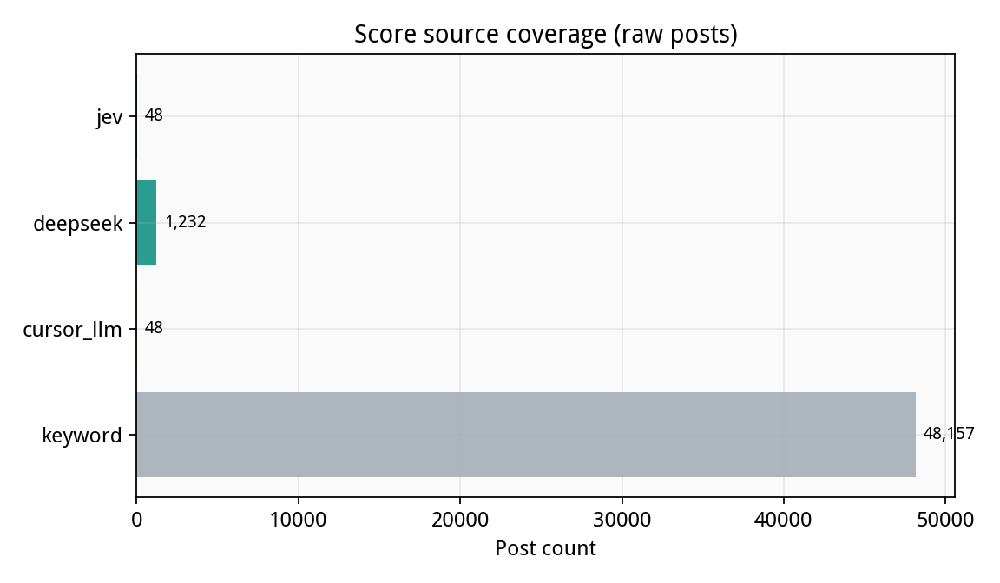
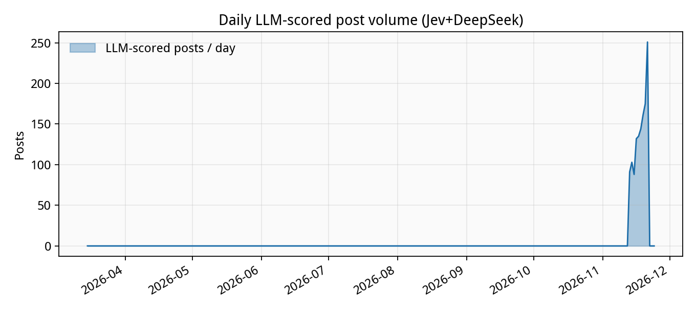
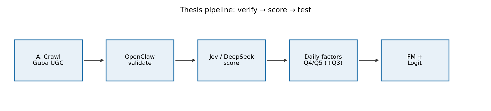
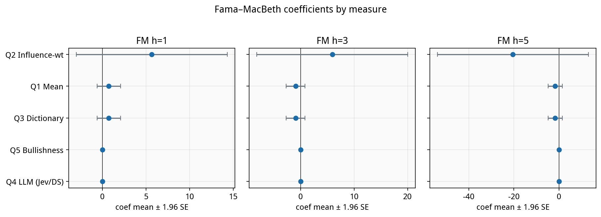
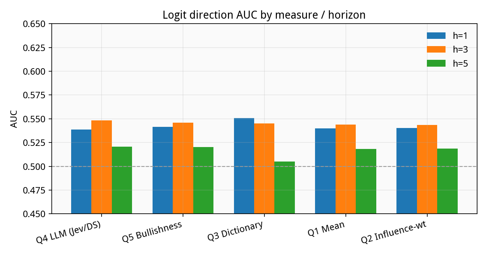

# 实证测试成果包（配图）

> 流水线：采集 → OpenClaw 验真（本轮以已有 raw 为主）→ **Jev/DeepSeek 打分** → FM/Logit。  
> 说明：当前 LLM 覆盖仍为样本级，主表用于验证链路与出图；扩大 `score_source=jev|deepseek` 后系数会更稳。

## 1. 样本与打分覆盖

| score_source | rows |
|--------------|------|
| keyword | 48157 |
| deepseek | 1232 |
| jev | 48 |
| cursor_llm | 48 |

- 面板标的—日：1591  
- 含 LLM 帖的标的—日：456  
- 合并收益观测：见 `thesis_panel_merged.csv`

## 2. Fama–MacBeth（主看 Q4 sent_llm）

### Q4 sent_llm

| h | coef_mean | SE | t | n_days | n_obs |
|---|-----------|----|---|--------|-------|
| 1 | 0.0004 | 0.0004 | 0.851 | 49 | 1031 |
| 3 | 0.0012 | 0.0013 | 0.933 | 47 | 897 |
| 5 | 0.0015 | 0.0015 | 1.041 | 45 | 791 |

### Q5 bullishness

| h | coef_mean | SE | t | n_days | n_obs |
|---|-----------|----|---|--------|-------|
| 1 | 0.0108 | 0.0087 | 1.243 | 49 | 1031 |
| 3 | -0.0060 | 0.0114 | -0.527 | 47 | 897 |
| 5 | -0.0175 | 0.0203 | -0.860 | 45 | 791 |

### Q3 sent_dict（基线）

| h | coef_mean | SE | t | n_days | n_obs |
|---|-----------|----|---|--------|-------|
| 1 | 0.7400 | 0.6873 | 1.077 | 49 | 1031 |
| 3 | -0.9429 | 0.9017 | -1.046 | 47 | 897 |
| 5 | -1.6774 | 1.5865 | -1.057 | 45 | 791 |

## 3. Logit 涨跌方向

### Q4 sent_llm

| h | coef | accuracy | AUC | n_obs |
|---|------|----------|-----|-------|
| 1 | 0.3264 | 0.549 | 0.539 | 1049 |
| 3 | 0.6676 | 0.553 | 0.548 | 915 |
| 5 | 0.6569 | 0.523 | 0.520 | 809 |

### Q5 bullishness

| h | coef | accuracy | AUC | n_obs |
|---|------|----------|-----|-------|
| 1 | 0.1379 | 0.544 | 0.542 | 1049 |
| 3 | 0.1627 | 0.550 | 0.546 | 915 |
| 5 | 0.0218 | 0.519 | 0.520 | 809 |

## 4. 文件清单

| 文件 | 说明 |
|------|------|
| `data/reports/thesis_fama_macbeth.csv` | FM 全表 |
| `data/reports/thesis_logit.csv` | Logit 全表 |
| `data/reports/thesis_models.md` | 文本摘要 |
| `data/reports/sentiment_panel.csv` | 日度情绪面板 |
| `data/reports/figures/fig1_*.png` … | 配图 |

## 5. 解读边界

- 本成果验证 **「验真→打分→测评」** 可跑通，并给出配图。  
- LLM 覆盖未全样本时，`sent_llm` 系数波动大、显著性偏弱属预期；下一步继续扩大 Jev/DS 覆盖后再出终表。  
- 检验的是可预测性，不声称因果。
